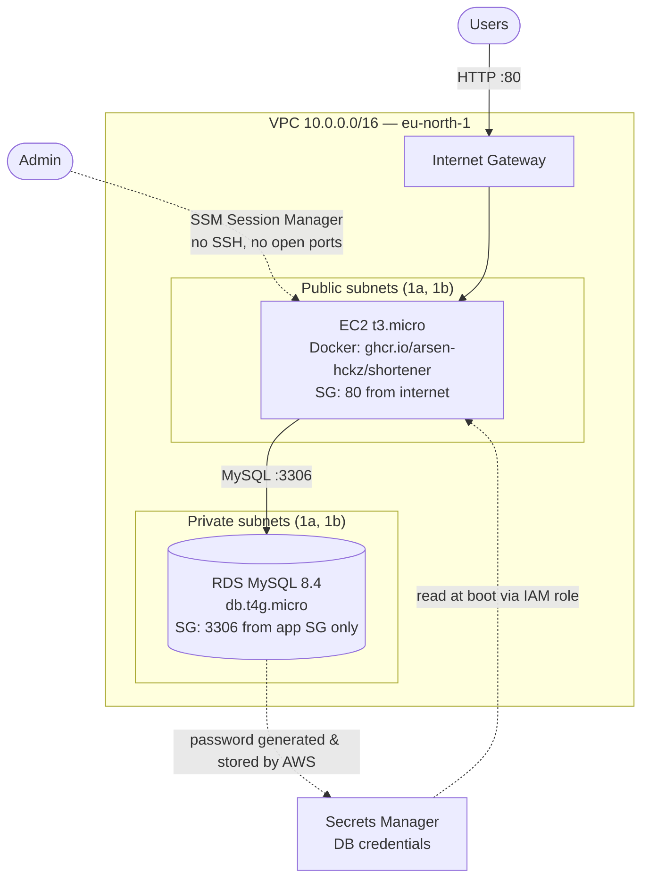

# URL Shortener on AWS — Terraform

Infrastructure as Code for deploying [Shortener](https://github.com/arsen-hckz/Shortener), a Django + DRF URL shortener, on AWS. One `terraform apply` builds the network, a private MySQL database and an app server running the containerized app. No passwords live in the code or in the Terraform state.

## Architecture



## Design decisions

| Decision | Why |
|---|---|
| **Database in private subnets, `publicly_accessible = false`** | The DB has no route to or from the internet. Only resources inside the VPC can reach it. |
| **DB security group allows the app's security group, not an IP range** | Only the app server can connect to MySQL. Any other machine added to the VPC is still blocked. |
| **`manage_master_user_password = true`** | AWS generates the DB password and stores it in Secrets Manager. It never appears in code, `.tfvars` or Terraform state. |
| **IAM role on the instance instead of access keys** | The server gets short-lived, auto-rotating credentials. There are no long-lived keys to leak. |
| **Least-privilege inline policy** | The app can call `secretsmanager:GetSecretValue` on **this DB's secret only**, not every secret in the account. |
| **SSM Session Manager instead of SSH** | No port 22 and no key pairs. Access is controlled by IAM and every session is logged. |
| **Modules per layer (`vpc`, `db`, `app`)** | Each layer is a reusable blueprint. A new environment means a new `envs/<name>` folder with different values. |
| **`for_each` over subnet maps** | Subnets are keyed by AZ (`["eu-north-1a"]`), not list position, so adding or removing one never reshuffles the others. |
| **Remote state in S3 with native locking** | State is versioned, encrypted, shared, and protected from concurrent `apply` runs. |

## Repository structure

```
.
├── modules/
│   ├── vpc/   # VPC, internet gateway, public/private subnets in 2 AZs, routing
│   ├── db/    # RDS MySQL, DB subnet group, security group
│   └── app/   # EC2, security group, IAM role + instance profile, boot script
└── envs/
    └── dev/   # backend + provider config, wires the three modules together
```

`envs/dev` is the only folder you run Terraform in. It passes outputs between modules: the VPC's subnet IDs go to the DB and the app, the app's security group goes to the DB, and the DB's host and secret ARN go to the app.

## How the app boots

The EC2 `user_data` script runs once at first boot. It:

1. Installs Docker.
2. Reads its public IP and Region from the instance metadata service (IMDSv2).
3. Fetches the DB username and password from Secrets Manager using the instance's IAM role.
4. Runs the app container, passing the configuration as environment variables. The container runs `migrate` and then starts gunicorn. Port 80 on the host maps to 8000 in the container.

## Prerequisites

- Terraform ≥ 1.10 (for S3 native state locking)
- AWS CLI configured with credentials that can create VPC, EC2, RDS, IAM and Secrets Manager resources
- An S3 bucket for remote state (set its name in `envs/dev/main.tf` → `backend "s3"`)
- The app image published and public on GHCR (see the [Shortener](https://github.com/arsen-hckz/Shortener) repo)

## Deploy

```bash
cd envs/dev
terraform init
terraform plan      # 18 resources
terraform apply     # ~10 min, mostly RDS
terraform output app_url
```

Allow 2–3 minutes after `apply` for the boot script to start the container.

## Troubleshooting

- **Boot script output:** EC2 → instance → Actions → Monitor and troubleshoot → Get system log.
- **Shell on the server:** EC2 → Connect → Session Manager, or:
  ```bash
  aws ssm start-session --target $(terraform output -raw instance_id)
  ```

## Cost

Approximately **$0.03/hour** while running in `eu-north-1`: EC2 `t3.micro`, RDS `db.t4g.micro`, and one public IPv4 address. Add a small amount for RDS storage and the Secrets Manager secret. Destroy the stack when you're not using it:

```bash
terraform destroy
```

## Possible next steps

- HTTPS: an Application Load Balancer with an ACM certificate and a custom domain
- An Auto Scaling Group across both AZs instead of a single instance
- GitHub Actions: build and push the image on commit, and run `terraform plan` on pull requests
- A `prod` environment (`envs/prod`) with Multi-AZ RDS
